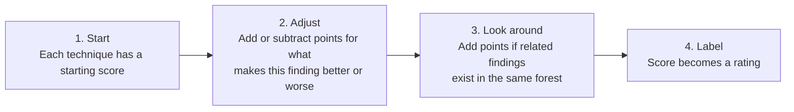

# How Locksmith2 Rates Risk

Every finding gets a **score** (a whole number, 0 or higher) and a **rating** (Informational to Critical). The score is built by adding and subtracting points. Nothing is multiplied.

Code: [Set-LS2RiskRating.ps1](../Private/Set/Set-LS2RiskRating.ps1). The numbers: `$script:ESCScoringMetadata` in [ESCDefinitions.ps1](../Private/Data/ESCDefinitions.ps1).

## 1. Starting score

| Start | Techniques |
|---|---|
| 3 | ESC6, ESC7a, ESC7m, ESC8, ESC11, ESC16, Auditing |
| 1 | ESC1, ESC4a, ESC4o, SchemaV1 |
| 0 | ESC2, ESC3c1, ESC3c2, ESC5a, ESC5o, ESC9, ESC13, ESC15 |

## 2. Adjustments

Each technique uses only some of these.

| Adjustment | Points | Used by |
|---|---|---|
| Template is enabled | +1 | ESC1, ESC2, ESC3c1, ESC3c2, ESC4a, ESC4o, ESC9, ESC13, ESC15, SchemaV1 |
| Template is disabled | -2 | same as above |
| Who holds the risky permission | 0 to +3, see below | ESC1, ESC2, ESC3c1, ESC3c2, ESC4a, ESC5a, ESC7a, ESC7m, ESC9, ESC13, ESC15 |
| What kind of object it is | CA, enrollment service, or CA computer +2; OID or container +1; plus another +2 if it is NtAuthCertificates | ESC5a, ESC5o |
| How the CA web endpoint is exposed | HTTP +2; HTTPS with NTLM +2; HTTPS with Kerberos +1 | ESC8 |

**Who holds the permission**

| Who | Points |
|---|---|
| A trusted principal (for example Domain Admins) | 0 |
| An untrusted user or computer | +1 |
| An untrusted group | +2 |
| A broad, dangerous principal (for example Everyone) | +3 |

## 3. Related findings

If other findings exist in the **same forest**, some techniques gain points. Every bonus is capped at +2.

| This finding | Gains | When |
|---|---|---|
| ESC1, ESC2, ESC3c1, ESC3c2, ESC4a, ESC4o, ESC9, ESC13, ESC15 | up to +2, using the "who holds the permission" points of the related findings | The template is **disabled** and an ESC5a or ESC5o finding exists on a CA enrollment service |
| ESC2, ESC3c1 | up to +2, same method | An ESC15 finding exists on an enabled template |
| ESC3c2 | up to +2, same method | An ESC3c1 or ESC2 finding exists on an enabled template |
| ESC6 | +2 | An ESC9 or ESC16 finding exists |
| ESC9, ESC16 | +2 | An ESC6 finding exists |

## 4. Rating

A score below 0 counts as 0.

| Score | Rating |
|---|---|
| 0 or 1 | Informational |
| 2 | Low |
| 3 | Medium |
| 4 | High |
| 5 or more | Critical |

## Examples

| Finding | Math | Score | Rating |
|---|---|---|---|
| ESC1 on an enabled template that Everyone can enroll in | 1 start + 1 enabled + 3 dangerous principal | 5 | Critical |
| ESC8 where the CA web endpoint uses HTTP | 3 start + 2 HTTP | 5 | Critical |
| ESC8 where the endpoint uses HTTPS with Kerberos | 3 start + 1 Kerberos | 4 | High |
| ESC1 on a disabled template that only Domain Admins can enroll in | 1 start - 2 disabled + 0 trusted principal = -1, counted as 0 | 0 | Informational |

Each finding also records how it got its score, in the `RiskScoring` property (for example `BaseScore: 3`, `EndpointBonus(HTTP): +2`).

Findings whose technique has no entry in `ESCDefinitions` are not rated.
